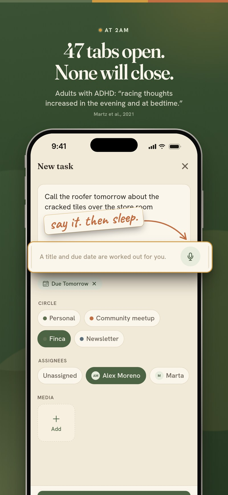
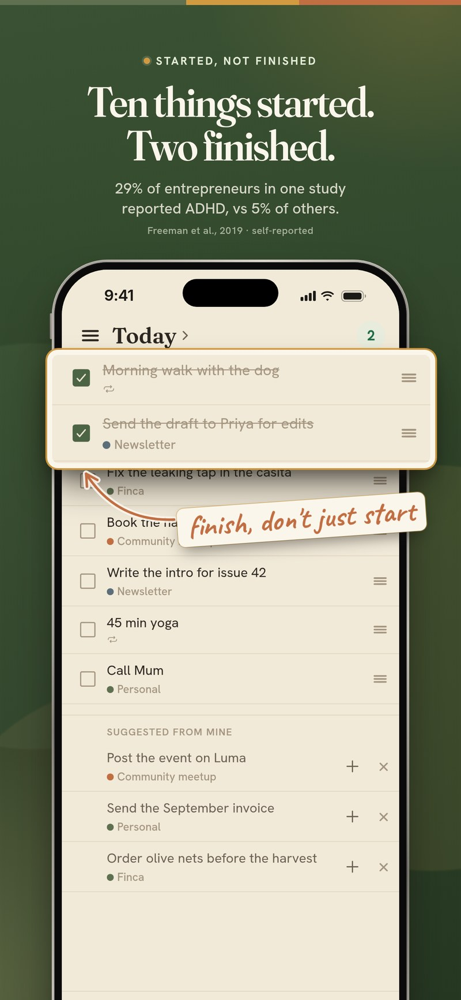
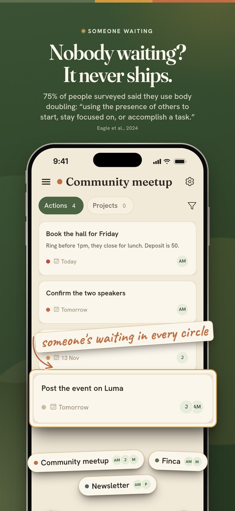
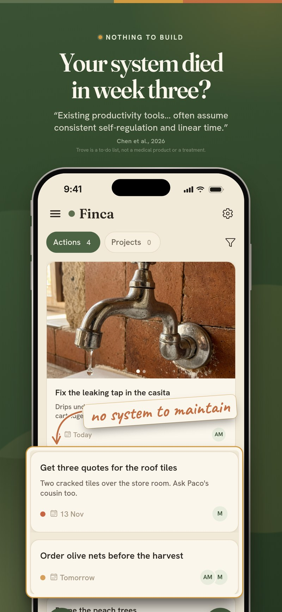

<p align="center">
  
</p>

<h1 align="center">Trove</h1>

<p align="center">
  <strong>The ADHD planner for founders with ten projects.</strong><br />
  Built by one. Open source.
</p>

<p align="center">
  <a href="https://troving.app">troving.app</a>
  ·
  <a href="https://apps.apple.com/app/id6818141231">App Store</a>
  ·
  <a href="https://app.troving.app">Open the web app</a>
</p>

---

**Lying awake with 47 tabs open in your head? Close them in 10 minutes and start finishing what you start.**

Trove is a to-do list for ADHD founders with too many projects. Say it out loud. Trove turns it into one list, with the work that matters on top. Every project goes to the people waiting on it. And there's finally room for the rest of your life.

It isn't a willpower problem. You've got drive to spare. You've just got nowhere to put it.

<p align="center">
  
  
  
  
</p>

## Who it's for

Founders running more than one project, with other people in them, and a brain that starts ten things before it finishes two. If that sounds like you, Trove is for you, whether or not you have an ADHD diagnosis.

## Why other tools fail you

It's not your brain. It's what you've been handed.

Researchers who interviewed 22 adults with ADHD say today's productivity tools “often assume consistent self-regulation and linear time.” ([Chen, Meng & Nie, 2026](https://doi.org/10.1145/3816978))

- **Notion.** You build a Life OS. Then you maintain it. Then the system is the job. Trove has nothing to build.
- **Jira and Linear.** Made for software teams. Sprints for your house? Tickets for your mum? And your people will never join a Linear project.
- **Planners and bullet journals.** Beautiful for 14 days. Then into the drawer with the other six.
- **To-do apps.** Miss one day, get a red wall. Miss three, stop opening it. In Trove, yesterday stays in yesterday.
- **ADHD planners.** Kind. Calm. Built for one. Nobody else is in there, so nobody's waiting.
- **AI assistants.** Brilliant at busywork. Not a place to keep a life.

**Trove isn't a bigger system. It's a smaller one, with people in it.**

## What the research says

Trove is built around what studies on adult ADHD keep finding. These figures are the ones published on [troving.app](https://troving.app), each with its source.

- **29% of entrepreneurs in one US study reported ADHD**, against 5% of the comparison group ([Freeman, Staudenmaier, Zisser & Andresen, 2019](https://link.springer.com/article/10.1007/s11187-018-0059-8), self-reported, one study). Worldwide, about 2.6% of adults have ADHD that started in childhood ([Song, Zha, Yang et al., 2021](https://pmc.ncbi.nlm.nih.gov/articles/PMC7916320/)).
- **“ADHD is not a disorder of knowing what to do. It's a disorder of doing what you know.”** Russell Barkley, PhD, as quoted by [CHADD](https://chadd.org/attention-article/was-grandma-right-about-manners/).
- **Out of sight, out of mind.** Adults with ADHD “recalled and executed less of their own real-life intentions,” and that gap was linked to procrastination ([Altgassen, Scheres & Edel, 2019](https://doi.org/10.1007/s12402-018-0273-x)). In Trove, everything you meant to do lives on one list.
- **Time feels different.** A meta-analysis of 55 studies found people with ADHD judge time less accurately, with errors “indicative of an accelerated internal clock” ([Marx, Cortese, Koelch & Hacker, 2022](https://doi.org/10.1016/j.jaac.2021.12.004)). In Trove, every line has a day. Didn't finish? It stays on its day, and tomorrow you decide.
- **Someone waiting works.** 75% of people surveyed said they use body doubling: “using the presence of others to start, stay focused on, or accomplish a task” ([Eagle, Baltaxe-Admony & Ringland, 2024](https://doi.org/10.1145/3689648), n = 165 of 220). In Trove, every project gets a circle with the people in it.
- **The 2am list is real.** In one study, racing thoughts in adults with ADHD “increased in the evening and at bedtime” ([Martz, Bertschy, Kraemer, Weibel & Weiner, 2021](https://doi.org/10.1016/j.psychres.2021.113988)). A review of 42 studies found adults with ADHD take longer to fall asleep ([Lugo, Fadeuilhe, Gisbert et al., 2020](https://doi.org/10.1016/j.euroneuro.2020.07.004)). In Trove, you can write tomorrow's first line tonight, then close the phone.

The full notes, and what each finding changed in the app, are on [troving.app](https://troving.app).

## Why I built it

> I've used Notion for almost a decade. I've spent several hundred hours in it, and I built my Life OS there. I've used every planning system going, from the Productivity Planner to the bullet journal. With some, you end up maintaining the system more than actually getting things done. Some are better, but they don't quite capture an ambitious entrepreneur with ADHD.
>
> I've got light ADHD, so much going on, and so much I want to build. I didn't want Jira or Linear for my life. And the people in my life were never going to join a Linear project. So I built Trove.
>
> — Luke Farrell, founder

## What Trove does

- **Say it out loud.** Tap the mic and talk. Trove writes the task for you, and works out a title, notes and a due date if you said one. It's out of your head and on the list.
- **One list, top to bottom.** Today pulls in what's yours from every project. The thing that matters goes on line one. Something urgent? Drag it up. Tick. Next.
- **Yesterday stays in yesterday.** Every line has a day. Didn't finish? It stays on its day, and tomorrow you glance back and decide: bring it, or let it go. No red wall of overdue tasks.
- **A circle for every project.** The business, the house, the community night, the family. Invite the people in it by email or link. No training, no per-person cost. Put a name on a line and it leaves your list. Someone's waiting, so it moves.
- **Room for the rest of your life.** Your private Personal circle sits on the same list as the business, so the yoga and the call to your mum stop losing every time. Set routines for the days you choose.
- **Photos on tasks.** Snap the leaking tap or the cracked tile and it's on the task, so whoever picks it up knows what they're looking at.
- **An agent can take a task.** Connect Claude, ChatGPT, Cursor or Grok and hand it a line, like “summarise the roof quotes”. It stays in the circle. You first, then your people, then an agent where it earns its place. See [docs/MCP.md](docs/MCP.md).

Trove is free during early access, on iPhone and in the browser at [troving.app](https://troving.app).

### The one rule

Trove's visibility is not a UI filter. It is one rule, enforced by the database:

> You can see or change a task only if you are a member of its circle.

That rule is a Postgres Row Level Security policy (see [`supabase/migrations`](supabase/migrations)), so it holds for every query the app can make, on every platform. Membership is the boundary. Mine is an extra filter on top of that: tasks assigned to you. It does not hide other people's tasks on a circle board you belong to.

## The 14-day promise

Give Trove ten minutes tonight. Use it for 14 days. Still opening it on day 14? It's working. If not, delete it. You can delete your account from inside the app.

## Not a medical product

Trove is a to-do list, not a medical product or a treatment. It doesn't treat ADHD. It's built by someone with ADHD, around the things that trip us up. If ADHD is getting in the way of your life, talk to your GP or a clinician.

## Built with

One TypeScript codebase, shipping on iPhone and the web (and runnable locally on Android too):

- [Expo](https://expo.dev) SDK 56 / React Native 0.85, with Expo Router for file-based navigation
- [Supabase](https://supabase.com): Postgres, Auth, Row Level Security, Storage, and Edge Functions
- [TanStack Query](https://tanstack.com/query) for data and mutations
- Reanimated + Gesture Handler for drag, swipe, and motion
- [react-native-fast-confetti](https://github.com/AlirezaHadjar/react-native-fast-confetti) (Skia) on native, canvas-confetti on web
- Fraunces + Hanken Grotesk, and a warm hand-rolled design system
- EAS for builds and deployment

## Run it locally

You'll need Node 20.19+ (or 22) and a [Supabase](https://supabase.com) project. Apply the SQL in [`supabase/migrations`](supabase/migrations) in filename order, then set the Auth redirects described in [`supabase/README.md`](supabase/README.md). `supabase/seed.sql` is local demo data only. Do not run it on a hosted project.

Copy [`.env.example`](.env.example) to a `.env` in the project root and fill in your project URL and anon (publishable) key:

```
EXPO_PUBLIC_SUPABASE_URL=your-project-url
EXPO_PUBLIC_SUPABASE_ANON_KEY=your-publishable-key
```

There is an optional `EXPO_PUBLIC_MCP_RESOURCE_URL` if you want to override the assistant URL shown in the app. Leave it blank to use the default.

Then:

```bash
npm install
npx expo start --web     # web, at localhost:8081
npx expo run:ios         # iOS simulator (dev build; Expo Go won't cover the native modules)
npx expo run:android     # optional, local Android
```

Connecting an AI assistant is documented in [`docs/MCP.md`](docs/MCP.md). Store listing copy, a Mac distribution note, and a privacy policy draft live in [`store/`](store/).

## Contributing

Issues and pull requests are welcome. This is an open source product, and the door is open.

Keep the tone of the product in mind: warm, plain, human. If you're proposing a feature, open an issue first so we can talk it through. Run `npm test` and `npm run typecheck` before pushing. Please don't commit secrets, real `.env` values, or anything from `supabase/.temp/`.

## License

[AGPL-3.0](LICENSE). You can use, study, and modify Trove freely; if you host a modified version for others, you share your changes under the same license.

---

<p align="center">Built in the open by <a href="https://github.com/the-react-native-rewind">The React Native Rewind</a>.</p>
